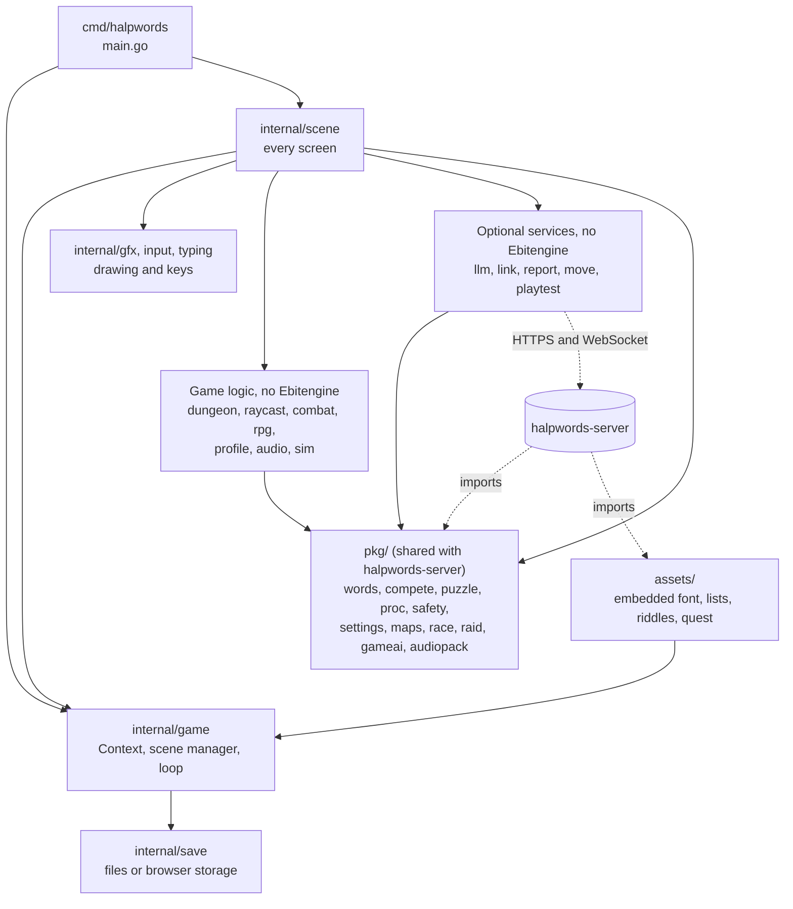
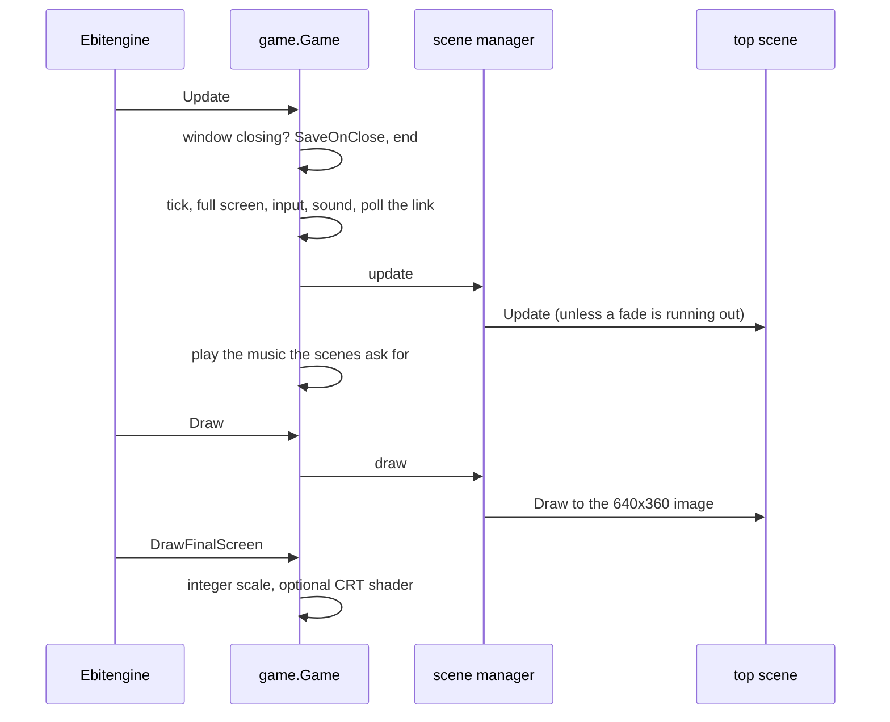
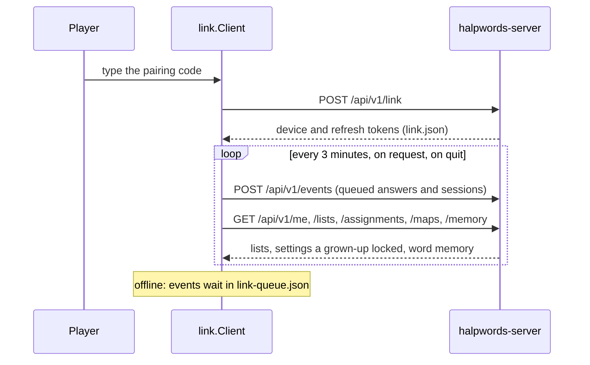

# Architecture

How the Halpwords game is put together. For the reasons behind the design,
and what is planned, read [PLAN.md](../PLAN.md). For building and shipping,
read [RELEASING.md](RELEASING.md). Everything here was checked against the
code at the time of writing. If the code and this page disagree, the code
is right: please fix the page.

The game is Go, drawn with [Ebitengine](https://ebitengine.org). It is one
binary for macOS, Windows, Linux and the web (WebAssembly). It plays fully
offline. Two things are optional and never block it: an AI
([`internal/llm`](#ai-internalllm)) and a link to a grown-up's account on
halpwords-server ([`internal/link`](#the-link-to-the-server-internallink)).

## The big picture

Rules that keep this tidy (from [PLAN.md §3](../PLAN.md)):

- Game logic is plain Go with no Ebitengine import, so it is unit-tested
  and deterministic from a seed. Only `cmd/halpwords`, `internal/game`, `internal/scene`,
  `internal/gfx` and `internal/input` import Ebitengine (checked with
  `go list -deps`).
- `pkg/` is a public API that halpwords-server imports. It may not import
  Ebitengine, `internal/game`, `internal/scene` or `internal/gfx`, directly
  or through another package. `pkg/imports_test.go` checks this.
- A change to an exported name, or to behaviour the server relies on (list
  format, grading, scores, the map format), needs a note in
  [CHANGELOG.md](../CHANGELOG.md). Add, don't rename.
- Randomness is seeded. The same seed gives the same dungeon.

## Packages

### `pkg/`: shared with halpwords-server

The server's `go.mod` requires this module at a commit, so nothing here
changes for the server until it moves to a newer one. The server imports
every package below, and also `assets`.

| Package | What it holds |
|---|---|
| `pkg/words` | The word list format (`Parse`, `Format`, `LoadFS`), languages, answer grading and its tiers, Unicode matching, the Leitner word memory and `Deck`, mistake kinds, the Grimoire's numbers, Greek typing keys. |
| `pkg/compete` | Game modes (Adventure, Hardcore, Daily), the Hardcore score, seed and share codes, the Daily Dungeon, the Hall of Fame. |
| `pkg/puzzle` | The ten door and chest puzzles (reverse rune, odd one out, anagram, missing letters, spelling, pair matching, riddle, tumbler lock, crossword, gap fill) and their generators. |
| `pkg/proc` | Procedural pixel art: textures, the ten worlds ([worlds.md](worlds.md)), monsters, the hero, props, the picture set for sign-in, the app icon. |
| `pkg/safety` | The family-safe policy that starts every AI request, and the filter for text that comes back. |
| `pkg/settings` | Per-language settings (grading rules, highlights, timer) that a grown-up can lock. |
| `pkg/maps` | The `.hwmap` and `.hwquest` formats and the checks a map must pass. |
| `pkg/race` | The rules of a Race in Play Together, and the checks the server runs on racers' reports. |
| `pkg/raid` | The rules of a Boss Raid: health, damage, dodges, grading, the boss sprite. |
| `pkg/gameai` | The AI prompts, JSON replies and checks for floor scripts, gap-fill sentences, riddles, taunts and memory tips. |
| `pkg/audiopack` | The format of a word list's pronunciation audio (a zip with a `pack.json`). |

`pkg/doc.go` lists them too.

### `internal/`: the game

| Package | What it does | Ebitengine? |
|---|---|---|
| `game` | `Context` (what every scene shares), the scene manager, the loop, sound, the CRT shader, crash reports, learners, the glue to the link and the AI. | yes |
| `scene` | Every screen: title, practice, the dungeon crawl, settings, word lists, account, and so on (see [Scenes](#scenes)). | yes |
| `gfx` | Drawing helpers: text, windows, torches, sparks. | yes |
| `input` | Keyboard state, once per tick. | yes |
| `dungeon` | Floor generation, monsters, traits, features, the saved state of a floor, building a floor from a map. | no |
| `raycast` | The first-person view, drawn on the CPU into an image, with world lighting, decor and particles. | no |
| `combat` | Battle formulas and monster traits. | no |
| `rpg` | The hero: classes (Knight, Scribe, Rogue), stats, levels, items and gear. | no |
| `typing` | The text field for battles and puzzles, Tab accents, Greek input. | no |
| `profile` | What lasts between adventures: settings, word memory, Hall of Fame, and the learners on this computer. | no |
| `save` | Reading and writing files (see [Save data](#save-data)). | no |
| `audio` | The sound effect synth, the music composer, per-world ambience. It only makes samples. | no |
| `llm` | The AI service (see below). | no |
| `link` | The client for halpwords-server (see below). | no |
| `qr` | The QR code encoder for the link screen: byte mode, level M, versions 1–10. | no |
| `report` | The pause menu's reports, queued on disk and sent to `POST /api/v1/reports`. | no |
| `move` | Carries a web player's saves from one address to another. | no |
| `playtest` | The web game's play-test of a quest fetched from its own website. | no |
| `browser` | Opens the website's sign-in page (system browser, or leaves the page on the web). | no |
| `clipboard` | Pasting from the system clipboard. | no |
| `sim` | Typing bots that play the dungeon, for `make balance` and balance tests. | no |
| `pal` | The 32-colour palette (DawnBringer 32). | no |
| `unifont` | Parser for GNU Unifont `.hex` bitmap fonts. | no |

### Everything else

| Path | What |
|---|---|
| `cmd/halpwords` | The entry point: window, icon, then `game.New` and `ebiten.RunGame`. |
| `assets/` | Files embedded with `go:embed` (see [Assets](#assets-and-word-lists)). |
| `tools/` | Small programs: `balance`, `sfxdump`, `icon`, `fontsubset`, `worldsheet`. |
| `build/` | The macOS `Info.plist` and the web page template. |
| `web/moved/` | The "We've moved" page for the web game's old address. |
| `docs/` | These docs, the screenshots in `docs/media`, and `docs/cutover/release.yml`. |
| `plugins/halpwords/` | Claude Code review agents for contributors. See its README. |

## Start-up and the game loop

`main` sets the window (logical size 640×360, resizable, closing handled by
the game), builds the icon from `proc.IconAt`, and calls `game.New` with the
first scene. The first scene is the title, or in the web game a play-test
when the page address has `?quest=…` (then `save.UseMemory` keeps every file
in memory).

`game.New` builds the `Context`:

1. the Unifont face from the embedded font;
2. the learners on this computer, then the link to the server for the
   learner playing;
3. the word lists, the profile, the settings a grown-up locked;
4. the AI service (`llm.Load`), connected to Halpwords AI through the link;
5. the report outbox, flushed in the background.

Ebitengine then calls these on every tick. Its default rate of 60 ticks a
second is used; the game never changes it.

- `Layout` always returns 640×360. `DrawFinalScreen` scales by the largest
  whole number that fits and letterboxes the rest, so pixels stay square.
  With the CRT filter on, a Kage shader does the scaling.
- Text is drawn at 1× from Unifont (8×16 glyphs). The 3D view is rendered at
  192×120 and drawn at 2×.
- A panic in the loop is caught by `guard`, written to `crash.txt` in the
  user's folder, and then re-raised.
- F3 (sound), F11 and Alt+Enter (full screen) are handled in `Update` for
  every scene.

### Scenes

A scene has `Update(ctx)` and `Draw(dst, ctx)`. The manager keeps a stack.
`ctx.Push`, `ctx.Pop` and `ctx.Replace` don't act at once: they fade to
black for ten ticks, change the stack, and fade in for ten. Only one
change runs at a time. A scene can also implement:

- `Musical`: its own music track. Otherwise the music of the scene under it
  is used, or the title music.
- `Closer` (and `Hider` for a web page that is only hidden): save what must
  be kept when the window closes or the tab goes. `ctx.SaveOnClose` calls
  them top first.

The screens, by file in `internal/scene`:

| Area | Scenes |
|---|---|
| Start | `Title` (the main menu), `NewGame`, `Adventure` (pick a language), `ClassPick`, `ListPick`, `Quests`, `QuestPage` |
| Play | `Crawl` (the dungeon), `GameOver`, `Practice`, `Grimoire`, `HallOfFame` |
| Words | `WordLists`, the list editor, the Word Forge |
| Setup | `Settings`, `AISetup` |
| Account | `Account`, `Learners` (Switch learner), `SignIn`, `Choices` (My choices), `Assignments`, `Report` |
| Together | `Lobby`, `RaidScreen`, `RaceEnd` |
| Web | the "moved" start-up check (`move.go`), `Playtest` |

`Crawl` is the biggest. Exploring, battles, puzzles, the map, the pause menu,
shrines, campfires, the merchant and the inventory are all modes of one
scene (`modeExplore`, `modeBattle`, `modePuzzle`, …), so the 3D view stays on
screen. A `run` holds what carries over between floors: the language, the
`words.Deck`, the hero, the seed and its random generator, the mode.

### Runs and seeds

`dungeon.Generate(seed, depth)` makes a floor from a seed. A floor is never
saved whole: only its `dungeon.State` (opened doors, automap, chests,
monsters) is, and the rest is made again from the seed. Seed codes, the
Daily Dungeon (the seed comes from the date) and Hardcore scores live in
`pkg/compete`. Set `HALPWORDS_SEED` to replay a dungeon. How a floor looks
(its [world](worlds.md)) never touches the run's random numbers, so looks can
change without changing a seed's dungeon. Golden-hash tests in
`internal/dungeon` guard that.

## Save data

All files go through `internal/save`. Files are small, so they are read and
written whole. Names use forward slashes on every system.

| Where | How |
|---|---|
| Desktop | Files under `os.UserConfigDir()/halpwords`, such as `~/Library/Application Support/halpwords` on macOS. A write goes to a temporary file first and is renamed, so a crash never leaves half a save. `WritePrivate` makes the file readable by its owner only (mode 0600). |
| Web | The page's local storage, one key per file, with the prefix `halpwords/`. About 5 MB for everything. |
| Play-test | In memory only (`save.UseMemory`). |

Each learner on a computer has a folder, `profiles/<id>/`. A `save.Folder`
names one, so code that keeps writing after the learner changes (the link's
background sync) can't write into the next learner's folder. `save.Root` is
the user's folder itself.

| File | Where | Holds |
|---|---|---|
| `learners.json` | root | The learners on this computer, their names and sign-in locks. |
| `ai.json`, `ai-spend.json` | root | The AI provider, keys (private), models, budgets, and what has been spent. |
| `ai/bank-<lang>.json` | root | Generated gap-fills, riddles, taunts and tips, kept so they are paid for once. |
| `reports/queue.json` | root | Reports waiting to be sent. |
| `crash.txt` | root | The last crash. |
| `settings.json` | learner | Game and per-language settings. |
| `progress.json` | learner | The word memory (Leitner boxes) per language. |
| `halloffame.json` | learner | Finished runs. |
| `adventure.json` | learner | The one save slot: the last Save Shrine and an optional suspend point. It stores the seed and the run's random generator, the hero, the changed state of floors, the Director's scripts, and the quest if one is played. It has a `Version` (2 now). |
| `words/*.txt` | learner | Their own word lists. |
| `quests/` | learner | Quests and maps dropped on the window. |
| `assigned/` | learner | Lists a grown-up assigned, as the server sent them, and `<list>.audio` packs. |
| `link.json` | learner | The link's tokens (private). |
| `link-queue.json`, `link-parked.json` | learner | Events waiting to be sent, and events kept for the same learner to link again. |

A damaged file is kept beside the original as `name.<UTC time>.bad` (the
newest 3 copies of each file are kept), and the game starts empty for that
file. The first start of a game from
before learners moved its files into the first learner's folder.

When the web game moves address, `move.Exportable` decides what travels:
the saves and `learners.json`, but never `ai.json`, the link files,
`crash.txt`, `.bad` files or `reports/`. See [RELEASING.md](RELEASING.md).

## Assets and word lists

`assets/embed.go` embeds:

| Path | What |
|---|---|
| `assets/fonts/unifont-subset.hex` | The Unifont subset (Latin, Greek, symbols). `tools/fontsubset` rebuilds it. Licence in `OFL-1.1.txt`. |
| `assets/words/*.txt` | Starter lists: `french`, `latin`, `greek`, `irish`. |
| `assets/puzzles/riddles.txt` | English riddles that work for every language. |
| `assets/quests/*.hwquest` | Built-in quests (`scribes-cellars`). |

Tiles, monsters, items, music and sound are generated in code, so there are
no image or audio files.

`Context.LoadLists` builds the lists in this order: the starter lists, then
the learner's own `words/*.txt` (one with the same file name as a starter
list replaces it), then lists assigned through the link. Files that fail to
parse are listed in `Context.ListErrors` and shown on the Word Lists screen.
The list format is in [PLAN.md §4](../PLAN.md) and the README.

## AI (`internal/llm`)

The game never needs an AI. A parent or teacher can set one up in AI Helper.
Every request runs in the background and nothing waits for it.

- **Providers.** Anthropic, OpenAI, Meta and DeepSeek, spoken over plain
  `net/http` (two wire formats: the Claude Messages API and chat
  completions). Or **Halpwords AI**: for a linked game whose plan includes
  it, requests go to `POST /api/v1/ai/{task}` through the link, with no
  key. The Word Forge needs a provider with its own key.
- **Keys and money.** Keys are in `ai.json` (private) or an environment
  variable (`ANTHROPIC_API_KEY`, `OPENAI_API_KEY`, `MODEL_API_KEY` or
  `META_API_KEY`, `DEEPSEEK_API_KEY`). A per-provider budget stops requests
  that could cost more than is left.
- **Prompts and checks** live in `pkg/gameai`, shared with the server, and
  every reply is checked before use (filter from `pkg/safety`, length limits,
  right alphabet, answers must be in the word list). The AI never grades
  spelling.
- **Which words may go.** `Service.ShareOnly` sets the words an AI may be
  sent: the built-in lists and lists a grown-up sent or assigned, never the
  learner's own. A floor of only own words makes no request.

| Feature | Asked for | Without the AI |
|---|---|---|
| Dungeon Director | A floor's name, look, intro, wall notes, monster names, boss name. The next floor is asked for ahead of time (at most twice per floor). | The floor keeps its generated names and look. |
| Gap-fill puzzles and riddles | `FillWords` | The lists' own `>>` sentences and the fixed riddle bank. |
| Monster taunts | `FillTaunts` | No taunt. |
| Scroll of Insight | `FillTips`: memory tips for words missed twice | The campfire lists the weakest words without tips. |
| Word Forge | `Forge`, then a checking pass | Not available. |

A run stops asking after four failed requests in a row. Hardcore and the
Daily Dungeon use only fixed puzzles, so scores compare. Generated content
is kept in the bank (`ai/bank-<lang>.json`).

## The link to the server (`internal/link`)

An optional link to a grown-up's account on halpwords-server. The server
is `https://halpwords.com`, or `HALPWORDS_SERVER` if set. The game plays the
same unlinked or with the server down.

- **Never on the critical path.** Requests run in goroutines with timeouts.
  Events wait in `link-queue.json` (10,000 in a browser, 50,000 on the
  desktop; the oldest answers fold into daily totals).
- **If the server ends the link** (401 `invalid_token`: unlinked on the
  website, or progress consent withdrawn), the unsent events and that
  learner's parked ones are deleted at once. **If the link is only lost**
  (`token_reused` after a lost refresh answer, or an expired refresh
  token), they move to `link-parked.json` for that learner and are
  dropped after 30 days.
- **Endpoints used**, all under `/api/v1`: `link`, `link/class`, `token`,
  `unlink`, `me`, `events`, `memory`, `lists` (and `lists/{id}/audio`),
  `assignments`, `maps`, `runs`, `ranks`, `choices` (and its sub-routes),
  `ai/{task}`, `sso/start`, `sso/token`, `play/tickets`, and a WebSocket at
  `play` for Play Together. Reports go from `internal/report` to `reports`,
  without needing a link. The API itself is described in halpwords-server's
  `docs/api`.
- **Suspended and stopped.** A 403 `account_suspended` is not an unlink: the
  link, queue and lists stay. A learner who stopped their progress being
  kept plays as before, and the game drops what waited to be sent.
- **Web.** The same client runs on `fetch` and the browser's WebSocket. A
  page can't set `User-Agent`, so the web build sends `X-Halpwords-Client`.
  The server allows the web game's origin (CORS).

## Platform differences

Files ending `_js.go` are the web build; `_other.go` or `_file.go` the
desktop. They cover saving (`internal/save`), the clipboard, opening the
sign-in page (`internal/browser`), the page address (`game/page_js.go`,
`playtest/options_js.go`), `move`'s calls into the page, and the link's
WebSocket and queue size. The web build also saves when the page is hidden
or closed (`watchPage`), since a web game never gets to quit.

## Tools and tests

- `make test` runs `go test ./...`; `make vet` adds `go vet`, staticcheck
  and a gofmt check. `make check` runs both.
- `make balance` (`tools/balance`, using `internal/sim`) plays the dungeon
  with typing bots. CI runs it with `-runs 100 -floors 9`.
- `tools/worldsheet` renders contact sheets of the worlds for review.
- Render golden hashes in `internal/raycast` come in two sets, because the
  fused multiply-add on arm64 and some other CPUs moves an odd pixel.
- `pkg/imports_test.go` keeps `pkg/` free of graphics code.
